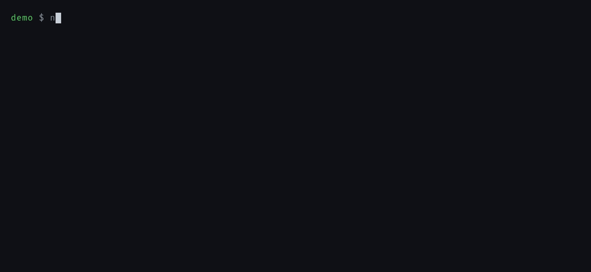

<div align="center">

# noidea

**Because you shouldn't have to think about commit messages.**

A small Python CLI that hooks into `git commit`, writes the message in your repo's own style, and
sends small diffs to cheap models.

[](https://pypi.org/project/noidea/)
[](https://pypi.org/project/noidea/)
[](https://noidea-ai.readthedocs.io)
[](https://github.com/AccursedGalaxy/noidea/blob/main/LICENSE)

<br>



**[Documentation](https://noidea-ai.readthedocs.io)** ·
**[Getting started](https://noidea-ai.readthedocs.io/en/latest/getting-started.html)** ·
**[Changelog](CHANGELOG.md)**

</div>

## Quick start

```bash
pipx install noidea
noidea keys add       # stores your Anthropic key in the system keyring
noidea init           # run once per repository
```

Now run `git commit` without `-m`. Your editor opens with a suggested message already filled in,
ready to edit or throw away.

No API key? Use a local [Ollama](https://noidea-ai.readthedocs.io/en/latest/providers.html#ollama)
model instead.

## Why noidea

### It writes like your repo

Before each suggestion noidea reads your recent commits and copies
the house style: your scopes, whether you write bodies, how long your subjects are, and gitmoji if
you use them. Your history keeps reading like your team wrote it.

### Small commits cost less

Ordinary diffs go to a fast, cheap model, and only very large
changes go to the strong one. noidea tells you which one it picked.

### You always have the last word

noidea never commits for you. It fills in the editor on a
plain `git commit`, so there's no new command to remember. If you already wrote a message with
`-m`, `--amend`, or in a merge, noidea leaves it alone.

### Small and private

noidea is an MIT-licensed Python CLI with no telemetry, built to a strict
[safety-first style guide](STYLE.md). Your diff goes to the model you chose and nowhere else, and
with Ollama it never leaves your machine.

### Compared with other tools

|  | **noidea** | opencommit | aicommits | gptcommit |
|--|--|--|--|--|
| **Install** | `pipx install noidea` | `npm i -g opencommit` | `npm i -g aicommits` | `cargo` / `brew` |
| **Language** | Python | Node.js | Node.js | Rust |
| Hooks into `git commit` | ✅ | ✅ | ✅ | ✅ |
| Learns your repo's style | ✅ | ❌ | ❌ | ❌ |
| Cost-aware model routing | ✅ | ❌ | ❌ | ❌ |
| Multiple providers | ✅ 7 | ✅ | ✅ | partial |
| No Node.js required | ✅ | ❌ | ❌ | ✅ |
| GitHub Action | ✅ | ✅ | ❌ | ❌ |

## Providers

Anthropic is the default. OpenAI, Gemini, DeepSeek, Groq and OpenRouter work with a key, Ollama
runs locally without one, and any OpenAI-compatible server works through `base_url`. Switching is
one line of config:

```json
{ "llm": { "provider": "ollama" } }
```

See [Providers](https://noidea-ai.readthedocs.io/en/latest/providers.html) for keys, endpoints and
examples, and [Configuration](https://noidea-ai.readthedocs.io/en/latest/configuration.html) for
every setting.

## GitHub Action

noidea also runs on pull requests and posts a suggested squash-merge message as a comment:

```yaml
- uses: actions/checkout@v4
  with:
    fetch-depth: 0
- uses: AccursedGalaxy/noidea@main
  with:
    api-key: ${{ secrets.ANTHROPIC_API_KEY }}
```

The [GitHub Action guide](https://noidea-ai.readthedocs.io/en/latest/github-action.html) has the
full workflow, inputs and outputs.

## Documentation

- [Getting started](https://noidea-ai.readthedocs.io/en/latest/getting-started.html): install, keys,
  and your first commit
- [Commands](https://noidea-ai.readthedocs.io/en/latest/commands.html): every command and flag
- [How it works](https://noidea-ai.readthedocs.io/en/latest/how-it-works.html): routing, style
  learning, and exactly what is sent to the model
- [Troubleshooting](https://noidea-ai.readthedocs.io/en/latest/troubleshooting.html): fixes for the
  usual error messages

## Contributing

Bug reports and pull requests are welcome. [CONTRIBUTING.md](CONTRIBUTING.md) covers the
development setup, and the code follows [TigerStyle](STYLE.md).

## License

[MIT](LICENSE)
